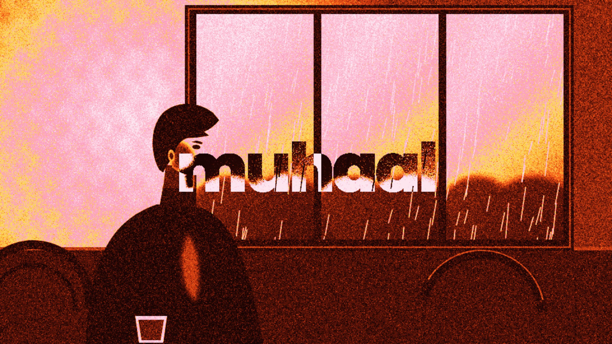
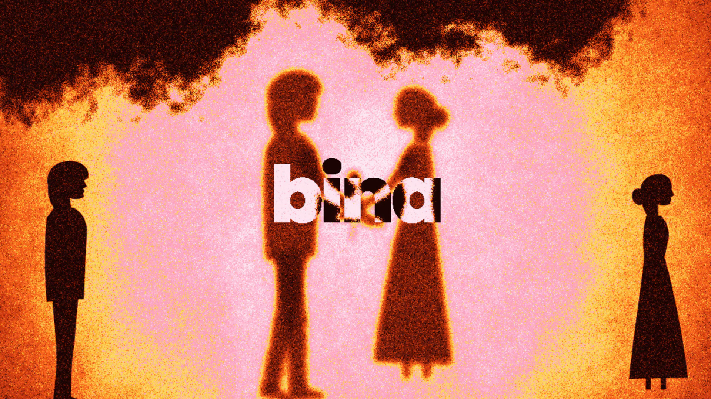
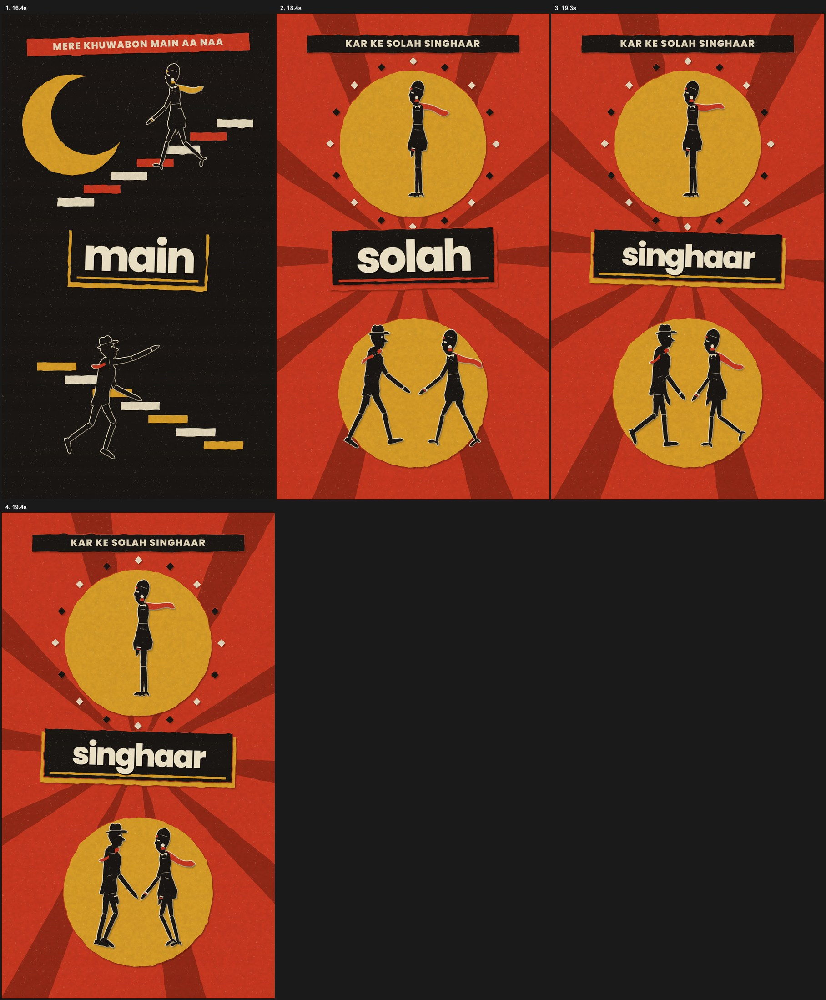

# SaaS Video [Created by codes]

Animated Lyric Videos for ***Pal Pal*** (`20.0s`, `30 fps`), created **100% in code** using HTML5 Canvas, GSAP, and [HyperFrames](https://github.com/heygen-com/hyperframes) with zero external stock images.

This repository includes **two complete code-generated editions** (both the rendered MP4 videos and the full source code required to build and render them):

1. **[Edition 1 — 16:9 Illustrated Tritone Lyric Video (Orange · Yellow Tint · Baby Pink)](#edition-1--169-illustrated-tritone-lyric-video-orange--yellow-tint--baby-pink)** (`1920×1080`, `tritone-16x9/`)
2. **[Edition 2 — 9:16 60s Spy Title Sequence Lyric Video](#edition-2--916-60s-spy-title-sequence-lyric-video)** (`1080×1920`, root directory)

---

## Edition 1 — 16:9 Illustrated Tritone Lyric Video (Orange · Yellow Tint · Baby Pink)

A **16:9 (`1920×1080`, `30 fps`, `20.0s`)** stippled charcoal & weathered-plaster illustrated lyric video graded in **Deep & Vibrant Orange**, a luminous **Golden Yellow tint in between**, and soft **Baby Pink** highlights, with pixel-exact **center word stencil inversion** (`Poppins ExtraBold`).

### 🎬 Watch / Download Edition 1 (16:9)
- **Full 1080p MP4 in Repo (`35.5 MB`)**: [`renders/pal-pal-orange-pink-16x9.mp4`](./renders/pal-pal-orange-pink-16x9.mp4)
- **Web Preview MP4 (`9.6 MB`)**: [`renders/pal-pal-orange-pink-16x9-preview.mp4`](./renders/pal-pal-orange-pink-16x9-preview.mp4)
- **GitHub Release Download (`v2.0.0`)**: [Latest Release (`v2.0.0`)](https://github.com/yathaarthj03-blip/SaaS-Video-Created-by-codes-/releases/tag/v2.0.0)

### 🖼️ Edition 1 Frame Previews (`1920×1080`)
| Scene 1A (`4.10s` — *"muhaal"*) | Scene 1B (`5.75s` — *"bina"*) |
| :---: | :---: |
|  |  |

### 🚀 Run & Render Edition 1 (`tritone-16x9/`) from Code
```bash
cd tritone-16x9
npx --yes hyperframes@0.8.143 preview
npx --yes hyperframes@0.8.143 check
npx --yes hyperframes@0.8.143 render -o ../renders/pal-pal-orange-pink-16x9.mp4 -q delivery
```

---

## Edition 2 — 9:16 60s Spy Title Sequence Lyric Video

A **9:16 (`1080×1920`, `30 fps`, `20.0s`)** cut-paper animated lyric video in the **60s Spy Title Sequence** (`spy-titles` — Saul Bass / Kuntzel+Deygas) style.

### 🎬 Watch / Download Edition 2 (9:16)
- **Full Master MP4 (`1080×1920`, `51.3 MB`)**: [`renders/pal-pal-60s-spy-lyric-video.mp4`](./renders/pal-pal-60s-spy-lyric-video.mp4)
- **Web Preview MP4 (`1080×1920`, `~7 MB`)**: [`renders/pal-pal-60s-spy-lyric-video-preview.mp4`](./renders/pal-pal-60s-spy-lyric-video-preview.mp4)
- **Direct Release Download**: [Release `v1.0.0`](https://github.com/yathaarthj03-blip/SaaS-Video-Created-by-codes-/releases/tag/v1.0.0)

### 🖼️ Edition 2 Storyboard & Frame Previews



| Scene 4 (`11.8s` — *"Ghar nahi jaata, mein bahar"*) | Scene 7 (`18.4s` — *"kar ke solah singhaar"*) |
| :---: | :---: |
|  |  |

---

## 📂 Repository Structure

```text
├── tritone-16x9/               # Edition 1: 16:9 Illustrated Tritone (Orange · Yellow Tint · Baby Pink)
│   ├── index.html              # 16:9 (1920x1080) HyperFrames composition & word timeline
│   ├── tritone-engine.js       # Stippled charcoal/plaster scene renderer, 1024-entry Tritone LUT & word stencil inverter
│   ├── snapshots/              # Verification frames (verify-muhaal-4.1s.png, verify-bina-5.75s.png)
│   ├── assets/song.mp3         # 20.0s audio track
│   ├── hyperframes.json        # HyperFrames config
│   └── package.json            # Package manifest
├── index.html                  # Edition 2: 9:16 (1080x1920) 60s Spy Title Sequence composition
├── spy-engine.js               # Edition 2: 60s Spy Title Sequence 2D Canvas cut-paper & character engine
├── assets/
│   └── song.mp3                # 20.0s audio track synced to both editions
├── renders/
│   ├── pal-pal-orange-pink-16x9.mp4             # Edition 1: 16:9 Orange-Yellow-Pink MP4 (1920x1080)
│   ├── pal-pal-orange-pink-16x9-preview.mp4     # Edition 1: Web-optimized 16:9 MP4
│   ├── pal-pal-60s-spy-lyric-video.mp4          # Edition 2: 9:16 60s Spy MP4 (1080x1920)
│   └── pal-pal-60s-spy-lyric-video-preview.mp4  # Edition 2: Web-optimized 9:16 MP4
├── TREATMENT.md                # Creative director treatment & 8-shot scene breakdown
├── SPEC.md                     # Word-by-word Whisper timestamp specification
├── REVIEW.md                   # Visual inspection & QA review log
└── CREDITS                     # Font & asset provenance
```
