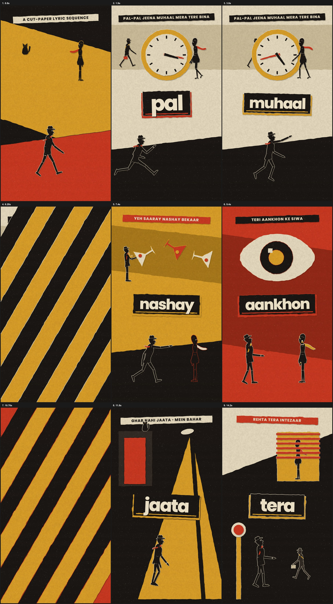
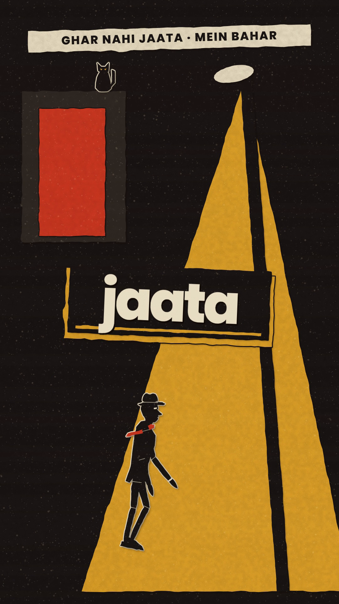
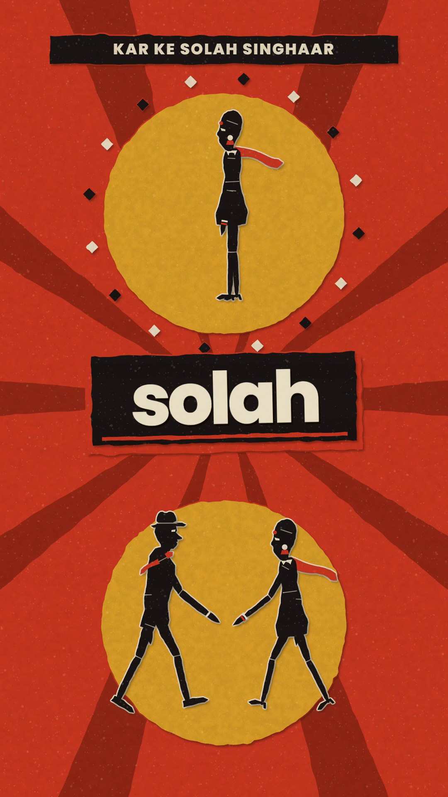

# SaaS Video [Created by codes]

A **9:16 (`1080×1920`, `30 fps`, `20.0s`) Animated Lyric Video** for *Pal Pal*, created **100% in code** using HTML5 Canvas, GSAP, and [HyperFrames](https://github.com/heygen-com/hyperframes) in the **60s Spy Title Sequence** (`spy-titles` — Saul Bass / Kuntzel+Deygas cut-paper) style.

---

## 🎬 Watch / Download the Rendered Video

Both the full master delivery render (`51.3 MB`) and a web-optimized preview (`~7 MB`) are included directly in this repository and in [GitHub Releases](https://github.com/yathaarthj03-blip/SaaS-Video-Created-by-codes-/releases):

- **Full Master MP4 (`1080×1920`, Delivery Quality, 51.3 MB)**: [`renders/pal-pal-60s-spy-lyric-video.mp4`](./renders/pal-pal-60s-spy-lyric-video.mp4)
- **Web Preview MP4 (`1080×1920`, Fast Stream, ~7 MB)**: [`renders/pal-pal-60s-spy-lyric-video-preview.mp4`](./renders/pal-pal-60s-spy-lyric-video-preview.mp4)
- **Direct Release Download**: [Latest Release (`v1.0.0`)](https://github.com/yathaarthj03-blip/SaaS-Video-Created-by-codes-/releases/tag/v1.0.0)

---

## 🖼️ Storyboard & Frame Previews

### Contact Sheet 1 (`0.8s` – `14.2s`)


### Contact Sheet 2 (`16.4s` – `19.4s`)


### Sample 1080×1920 Frames
| Scene 4 (`11.8s` — *"Ghar nahi jaata, mein bahar"*) | Scene 7 (`18.4s` — *"kar ke solah singhaar"*) |
| :---: | :---: |
|  |  |

---

## 🎨 Visual & Technical Architecture

Everything on screen is procedurally drawn in code with zero external stock images:

1. **4-Ink Cut-Paper Palette (`spy-engine.js`)**:
   - **Ink Black** (`#1b1714`), **Paper Cream** (`#efe4c9`), **Signal Red** (`#d23a22`), and **Mustard Gold** (`#e2a52a`) with procedural paper-fiber grain.
   - Deterministic polygon edge resampling (`roughC`) gives every prop, plaque, and character limb authentic scissor-cut paper edges that never boil across frames.
   - `3 px` ground-colour paper cut-gaps and `2.5 px` hard offset drop shadows.
2. **2D Cut-Paper Characters (Animated on Twos at `12 fps`)**:
   - **Fedora Agent**, **Mystery Woman**, **Perched Rooftop Cat**, **Briefcase Courier**, **Jazz Lounge Saxophonist**, and **Street Passerby**.
   - Characters are composited as unified silhouettes with thin `destination-out` internal joint slits (`slit()`) and flying red/mustard ties and scarves.
3. **Diagonal Strip-Shatter Scene Transitions**:
   - At every lyric line boundary (`1.58s`, `6.20s`, `8.46s`, `10.68s`, `12.98s`, `15.16s`, `17.46s`), 10 parallel 30° diagonal cut-paper strips slice across the canvas.
4. **Word-by-Word Whisper Audio Sync (`index.html`)**:
   - All 32 words across the 7 lyric lines are synced to the singing (`assets/song.mp3`) and stamped onto a central scissor-cut paper plaque with elastic spring overshoot.

---

## 📂 Repository Structure

```text
├── index.html                  # Main HyperFrames composition & word-level timeline (32 word clips)
├── spy-engine.js               # 60s Spy Title Sequence 2D Canvas cut-paper & character engine
├── assets/
│   └── song.mp3                # 20.0s audio track synced to the composition
├── renders/
│   ├── pal-pal-60s-spy-lyric-video.mp4          # Full master MP4 render (1080x1920, 30fps)
│   ├── pal-pal-60s-spy-lyric-video-preview.mp4  # Web-optimized MP4 render
│   ├── verify-spy-11.8s.png                     # Full-res verification frame (11.8s)
│   └── verify-spy-18.4s.png                     # Full-res verification frame (18.4s)
├── snapshots/
│   ├── contact-sheet-1.jpg     # Contact sheet grid (0.8s - 14.2s)
│   └── contact-sheet-2.jpg     # Contact sheet grid (16.4s - 19.4s)
├── TREATMENT.md                # Creative director treatment & 8-shot scene breakdown
├── SPEC.md                     # Word-by-word Whisper timestamp specification
├── REVIEW.md                   # Visual inspection & QA review log
├── CREDITS                     # Font & asset provenance
├── hyperframes.json            # HyperFrames project configuration
└── package.json                # Node package manifest
```

---

## 🚀 How to Run & Render from Code

### Prerequisites
- **Node.js 22+**
- **FFmpeg** (in system `PATH`)
- **Google Chrome** (used by HyperFrames for deterministic headless GPU frame capture)

### 1. Clone the Repository
```bash
git clone https://github.com/yathaarthj03-blip/SaaS-Video-Created-by-codes-.git
cd SaaS-Video-Created-by-codes-
```

### 2. Launch Live Preview
Open the interactive timeline player in your browser:
```bash
npx --yes hyperframes@0.8.143 preview
```

### 3. Run Linter, Runtime & Contrast Checks
```bash
npx --yes hyperframes@0.8.143 check
```

### 4. Render the Final MP4 Video
```bash
npx --yes hyperframes@0.8.143 render -o renders/pal-pal-60s-spy-lyric-video.mp4 -q delivery
```
